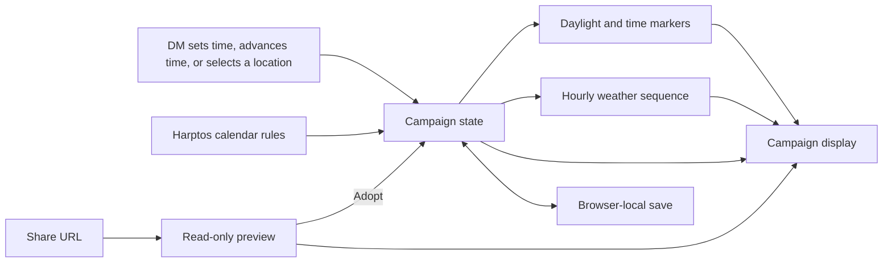

# Architecture

Vite serves [index.html](../index.html) and bundles the TypeScript app. [src/main.tsx](../src/main.tsx) opens a shared preview or restores the local campaign before mounting [src/App.tsx](../src/App.tsx). The [date editor](../src/components/clock-editor.tsx) and advance buttons use the same [Harptos calendar rules](../src/harptos.ts). The calendar module is independent of the browser and supports positive DR years within the safe integer range of elapsed minutes.

[src/campaign-state.ts](../src/campaign-state.ts) encodes the time as elapsed minutes from 00:00 on 1 Hammer 1 DR. It stores the clock, stable location ID, and unsigned 32-bit weather seed together under `harptos-calendar-tracker:campaign:v1`. The loader falls back to the earlier clock, location, and seed keys. The location catalog in [src/locations.ts](../src/locations.ts) supplies the accepted IDs, calendar tags, and light and weather profiles. The clock and editor use the selected location’s calendar. [src/setting-calendars.ts](../src/setting-calendars.ts) converts local dates to and from the same elapsed-minute timeline. The browser reads the saved snapshot on load or on return from preview. Edits use the in-tab campaign as their base, so a successful write includes any preceding edits made while storage was unavailable.

A share URL carries the same fields in `share=1`, `time`, `location`, and `seed` query parameters. A valid preview leaves browser storage untouched. Adoption writes a single snapshot before switching to editing mode. Leaving the preview removes the share parameters and keeps other query parameters and the fragment.

[index.html](../index.html) provides the search title and description before React loads. The production SEO plugin in [vite.config.ts](../vite.config.ts) uses one public homepage URL for the canonical link, Open Graph URL, site-name markup, and sitemap. Campaign share URLs load the same HTML and point to that homepage as their canonical URL.

[src/localization.ts](../src/localization.ts) uses typed message IDs for interface copy and campaign notices. It translates named setting terms and formats local dates. [src/App.tsx](../src/App.tsx) owns the browser-local language preference and passes it to the campaign screen and footer. The date editor uses the selected calendar’s periods for direct entry. [src/components/harptos-month.tsx](../src/components/harptos-month.tsx) displays the Harptos tendays and festival days. The campaign ledger in [src/App.tsx](../src/App.tsx) owns the campaign state, preview transitions, and derived daylight and weather. The preview, summary and copy controls, and location selector have their own components.

[src/daylight.ts](../src/daylight.ts) uses the selected calendar’s day index and seasonal anchors to estimate sunrise and sunset as minutes after midnight. The date and location determine both values, so advancing within a single day keeps its estimates. The calendar index includes festival days and Shieldmeet.

[src/time-markers.ts](../src/time-markers.ts) combines the clock with those estimates to derive the current phase. It also looks up named markers by clock time. Both labels are recalculated from the clock and location on every change.

[src/weather.ts](../src/weather.ts) derives the hourly condition from the date, hour, location, and campaign seed. Local campaign initialization generates a seed when none is saved. If storage is unavailable, the local campaign uses a fixed fallback seed.

## Campaign state and derived views

- **Calendar and clock.** Convert between a Harptos date and a continuous measure of campaign time. Validate the requested date and time before updating state. Keep regular dates and intercalary festivals distinct when parsing and formatting. Day advances add 24 or 240 elapsed hours, including festival hours.
- **Daylight and phase.** Derive sunrise and sunset from the Harptos date and solar profile, then combine them with the clock to find the current phase. Use a local light cycle for Sigil and steady light for the Radiant Citadel. The clock marker comes from a fixed range for each minute of the day.
- **Weather.** Derive surface front boundaries, wet and dry spells, and local fog and storm events from the seed and location. Weight front conditions by climate and seasonal daylight. Use cloudy transition hours around precipitation and build thunderstorms within rainy fronts. Planar locations use their own condition weights. Direct jumps and adopted share links use the same sequence as hourly advances.
- **Display and save.** Present the clock, daylight, weather, and location controls together. Restore the seed alongside the clock and location to reconstruct the current conditions. [src/campaign-summary.ts](../src/campaign-summary.ts) formats the same date, hour, phase, and weather shown by the clock as a single plain-text line.

## How a change lands

For a calendar change, identify the affected date boundary and verify both direct entry and time advances across it. For a daylight or weather change, check its output on the same campaign date in both locations. For a display or save change, run the set-time, advance, and reload flow together. Capture behavior changes in the relevant [decision record](decisions.md) and move the [roadmap item](roadmap-format.md) in the same change as the implementation.
