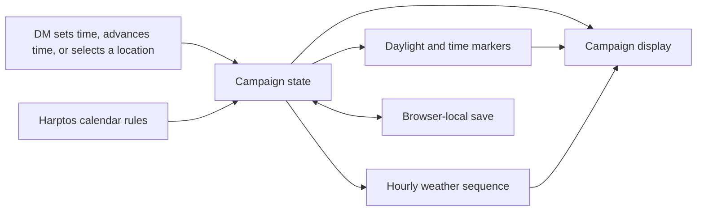

# Architecture

The repository has no application source or chosen runtime. This design describes the planned separation of responsibilities for the single-screen tracker. The component names are conceptual.

## Campaign state and derived views

- **Calendar and clock.** Convert between a Harptos date and a continuous measure of campaign time. Validate the requested date and time before updating state. Keep regular dates and intercalary festivals distinct when parsing and formatting. Day advances add 24 or 240 elapsed hours, including festival hours.
- **Daylight and phase.** Derive sunrise, sunset, and the current phase from the Harptos date, clock, and location. Keep named clock markers separate from daylight-dependent phases so a fixed marker can coexist with the date’s sunset estimate.
- **Weather.** Derive the condition from the campaign seed, location, elapsed hour, and previous condition. A jump over several hours must account for their transitions. Revisit a location or earlier hour using the same sequence. Consider checkpoints if long jumps expose a performance problem.
- **Display and save.** Present the clock, location, daylight, weather, and controls together. Save the valid clock, selected location, and seed together so derived values can be reconstructed on reload. A location change keeps the campaign time intact.

## How a change lands

For a calendar change, identify the affected date boundary and verify both direct entry and time advances across it. For a daylight or weather change, check its output on the same campaign date in both locations. For a display or save change, run the set-time, advance, and reload flow together. Capture behavior changes in the relevant [decision record](decisions.md) and move the [roadmap item](roadmap-format.md) in the same change as the implementation.
