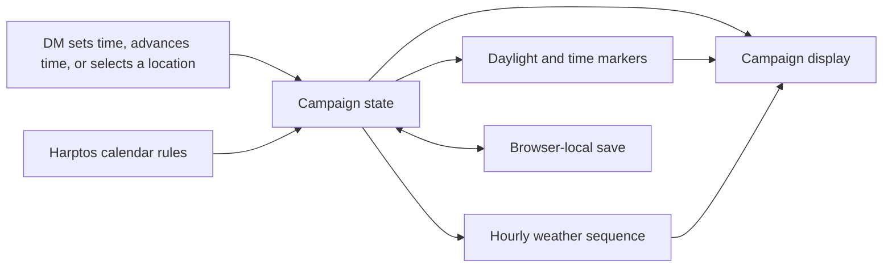

# Architecture

Vite serves [index.html](../index.html) and bundles the TypeScript app. [src/main.tsx](../src/main.tsx) mounts the React screen. [src/App.tsx](../src/App.tsx) restores the clock from `localStorage` and saves it after a valid edit or advance. The [date editor](../src/components/clock-editor.tsx) and advance buttons use the same [Harptos calendar rules](../src/harptos.ts). The saved value is a count of elapsed minutes from 00:00 on 1 Hammer 1 DR, stored under the versioned key `harptos-calendar-tracker:clock:v1`. The calendar module is independent of the browser and supports positive DR years within the safe integer range of elapsed minutes.

The [campaign location selector](../src/App.tsx) stores `neverwinter` or `phandalin` under `harptos-calendar-tracker:location:v1`. The clock and location use separate keys so switching locations leaves the saved clock intact. A missing or unknown location defaults to Neverwinter and the saved time is restored independently.

[src/daylight.ts](../src/daylight.ts) uses the Harptos day index and year length to estimate sunrise and sunset as minutes after midnight. The date and location determine both values, so advancing within a single day keeps its estimates. The calendar index includes festival days and Shieldmeet.

[src/time-markers.ts](../src/time-markers.ts) combines the clock with those estimates to derive the current phase. It also looks up named markers by clock time. Both labels are recalculated from the clock and location on every change.

The diagram includes the planned weather flow.

## Campaign state and derived views

- **Calendar and clock.** Convert between a Harptos date and a continuous measure of campaign time. Validate the requested date and time before updating state. Keep regular dates and intercalary festivals distinct when parsing and formatting. Day advances add 24 or 240 elapsed hours, including festival hours.
- **Daylight and phase.** Derive sunrise and sunset from the Harptos date and location, then combine them with the clock to find the current phase. Named clock markers use fixed times and can appear alongside the phase.
- **Weather.** Derive the condition from the campaign seed, location, elapsed hour, and previous condition. A jump over several hours must account for their transitions. Revisit a location or earlier hour using the same sequence. Consider checkpoints if long jumps expose a performance problem.
- **Display and save.** Present the clock, daylight estimates, and location controls together. When weather is added, restore the campaign seed alongside the clock and location to reconstruct the derived conditions.

## How a change lands

For a calendar change, identify the affected date boundary and verify both direct entry and time advances across it. For a daylight or weather change, check its output on the same campaign date in both locations. For a display or save change, run the set-time, advance, and reload flow together. Capture behavior changes in the relevant [decision record](decisions.md) and move the [roadmap item](roadmap-format.md) in the same change as the implementation.
